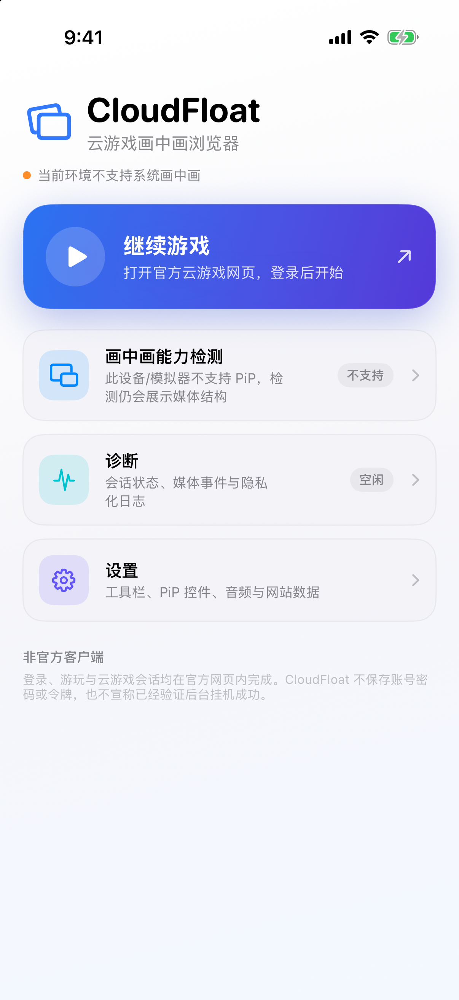
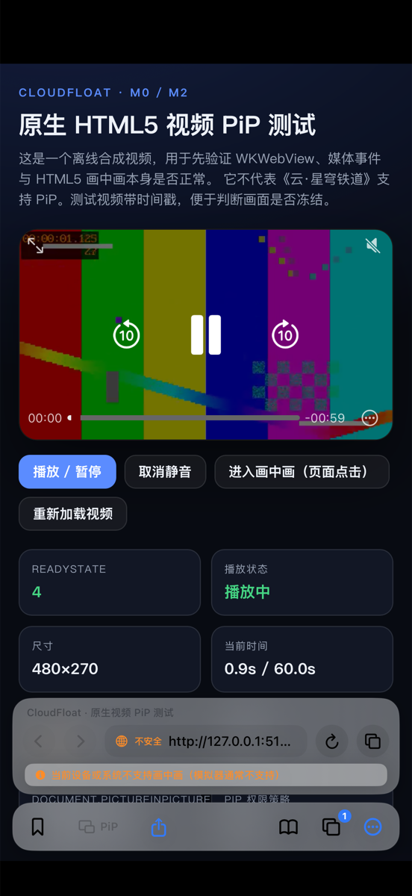
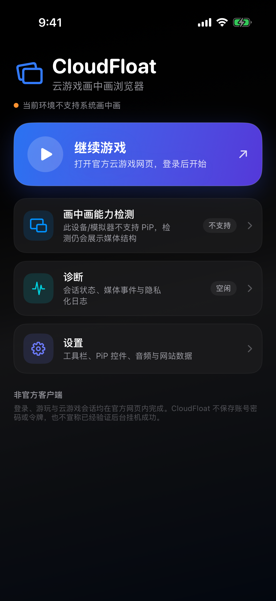

# Ariuno

Ariuno 是一个 iOS 原生（Swift + SwiftUI + WKWebView）现代浏览器原型，支持多标签、书签、历史、隐私浏览和任意网址访问；云游戏画中画只是内置的可选媒体能力。登录、游玩和云游戏会话都发生在官方网页内；App 不接收账号密码，不保存令牌，也不宣称已经实现或验证“后台挂机”。

> **当前状态（2026-11-17）**
> - 源码、工程配置、测试页与开发文档已实现；Debug/Release 构建、Release Archive 与 IPA 导出成功。
> - 自动化测试 **202 项全部通过**（多标签、标签冷启动恢复、标签缩略图、媒体轮询调度、PiP 来源安全关闭、书签、地址栏/搜索、历史、隐私浏览、起始页、下载暂停/续传/分享、状态机、媒体探测、跨域 iframe、Canvas、登录弹窗、隐私脱敏、诊断导出、本地 HTTP 服务）。
> - 另有 **5 项 XCUITest** 在模拟器上真实点击通过：起始页入口、新建标签、书签/历史面板、地址栏导航、冷启动标签恢复；另含 1 项设备专用 PiP 生命周期测试（模拟器自动跳过）。
> - Release IPA **0.70 MB**（723,820 字节），`.app` 1.7 MB，主可执行文件 1.58 MB；无第三方依赖、无内嵌浏览器引擎/动态库。
> - 重构后的 Ariuno 已在 iPhone 15 Pro 真机启动并显示起始页（系统画中画显示“支持”）。
> - 真机 Debug 启动已用 Instruments `App Launch` 实测：进程→首帧 **258.5 ms**，进程→Foreground Active **280.1 ms**（[证据摘要](docs/evidence/device-launch-2026-11-17.txt)）。
> - 云游戏 PiP 的场景 A–J（切标签后 PiP 持续、后台、关闭来源）仍未执行：需要测试者用自己账号登录并手动点击网页内 PiP 按钮；设备在采集后断开，相关项保持 **UNVERIFIED**。
> - 历史真机证据（重构前构建）：本地视频 PiP 5 分钟（T01 PASS）、官方登录并进入云游戏（T02 PASS）、登录跨升级保持（T09 PASS）、游戏自动战斗实时 PiP（T03 PASS，单次约 5 分钟）。
> - **T04/T05 FAIL**：后台无输入约 15 分钟后，游戏自身提示“长时间未操作游戏，已中断连接，错误码 -1022”，PiP 结束。App 没有也不应绕过服务器空闲超时。
> - 因此，本仓库**不能**作为“可后台挂机”的交付结论，只能交付浏览器 + 画中画能力探测 + 会话诊断原型。
> - 按任务书第 6 节：T05 未通过，不交付“可后台挂机”结论；本仓库按“浏览器和诊断原型”交付，并在 [known-limitations.md](docs/known-limitations.md) 解释失败原因。
> - **用户已于 2026-11-16 明确接受该缩小交付范围**（[接受记录](docs/scope-acceptance.md)）；T04/T05 保持 FAIL，不宣称后台挂机。
> - M4 原生媒体管线标记为 **Not Feasible**：缺少官方授权、文档化的独立实时媒体流与输入/会话一致性保证。



浏览器壳（地址栏、标题、HTTP 不安全提示、标签数量角标）：



深色模式：



## 它做什么

- 用多个独立 `WKWebView` 标签页浏览任意网址；地址栏支持网址/域名/IP/IP:端口/搜索关键词，自动补全 HTTPS，不内置、不写死任何站点。
- 提供书签（文件夹/排序/持久化）、历史（搜索/删除/清空）、前进/后退、刷新/停止、分享、主页、标签切换等 Safari 式基础浏览功能。
- 新标签显示浏览器首页；空白标签不会自动打开任何云游戏站点。
- 标签页支持卡片预览（缩略图存 Caches）、数量角标、滑动/批量关闭、关闭其他/全部、最近关闭恢复。
- 标签元数据（URL/标题/上次活动标签）版本化持久化；冷启动只恢复元数据，首次激活时才加载页面，避免一次启动 20 个请求。
- 真机登录、Cookie、网页输入由官方网页自身处理；系统移动端 User-Agent 保持不变。
- 页面加载后向每个 frame 注入只读媒体探测脚本，观测 `video`、`canvas`、`iframe`、`readyState`、PiP 能力与媒体事件；不采集媒体 URL。
- 优先使用网页 HTML5 PiP；当原生 `evaluateJavaScript` 缺少用户激活时，提供页面内轻量 PiP 控件并如实提示。
- 用独立状态机区分：PiP 浮窗是否显示、媒体是否仍有播放观测、服务器端会话是否持续（后者始终显示 UNVERIFIED）。
- 统一媒体轮询调度：只有活动标签与 PiP 来源标签持有探测定时器（最多 2 个），进入后台全部停止；事件驱动为主，3 秒低频刷新仅作兜底。
- PiP 全局生命周期：来源标签与当前选中标签解耦；关闭来源标签时先请求系统停止 PiP，收到离开事件（或 1.5 秒兜底）后才销毁 WebView；音频会话按全局 PiP 状态保持，不因切换标签被误关。
- 诊断日志在内存中生成，导出前脱敏；无账号密码、Cookie 值或完整带 token URL。
- 离线测试页：原生视频、仅 Canvas、跨域 iframe、登录弹窗样例；Debug 构建可启动仅回环的本地 HTTP 服务。
- 云游戏小窗 PiP 仍保留，但不再绑定特定站点；只要当前网页视频支持 HTML5 PiP 即可使用。

## 它不做什么

- 不自动开始下一轮战斗、不做自动点击脚本、不绕过服务器空闲超时。
- 不使用私有 API、静音音频保活、位置/VoIP 伪后台、后台截图转视频。
- 不忽略证书错误，不读取或打印 HttpOnly/登录令牌。
- 不承诺 PiP 浮窗可直接操作游戏（必须点小窗回到 App）。
- 不在官方页面之外收集账号密码，不接入自建服务器/第三方转码。
- 不把“PiP 出现”“最后一帧仍在”或“JS 心跳”当作服务器会话持续的证明。

## 环境要求

- macOS + Xcode 27.2（已在 Xcode 27.2 / iOS 27.2 SDK 验证构建）
- iOS 17.0+（工程 Deployment Target；真机建议覆盖当前 iOS 与至少一个较低主要版本）
- [XcodeGen](https://github.com/yonaskolb/XcodeGen) 2.46+（`project.yml` 是工程源文件）
- 真机验证需要真实 iPhone；云游戏验证需要用户自己的官方账号。本仓库**不提供**测试账号或凭证。

## 构建

```bash
cd Ariuno
xcodegen generate
open Ariuno.xcodeproj
```

命令行构建（模拟器，示例设备名以 `xcodebuild -showdestinations` 为准）：

```bash
xcodebuild \
  -project Ariuno.xcodeproj \
  -scheme Ariuno \
  -configuration Debug \
  -destination 'platform=iOS Simulator,name=iPhone 17 Pro,OS=26.3.1' \
  -derivedDataPath build/DerivedData \
  CODE_SIGNING_ALLOWED=NO \
  build
```

真机构建需在 Xcode 中设置自己的 Development Team；本地测试服务器、调试启动参数与测试页实验室只在 Debug 构建中暴露/启用。

## 测试

```bash
xcodebuild \
  -project Ariuno.xcodeproj \
  -scheme Ariuno \
  -configuration Debug \
  -destination 'platform=iOS Simulator,name=iPhone 17 Pro,OS=26.3.1' \
  -derivedDataPath build/DerivedData \
  test
```

最近一次结果（2026-11-17，iPhone 17 Pro / iOS 26.3.1 模拟器）：

```text
Executed 202 tests, with 0 failures (0 unexpected)
** TEST SUCCEEDED **

# UI 测试（另运行）
xcodebuild ... -scheme AriunoUITests test
Executed 5 tests, with 0 failures (0 unexpected)
** TEST SUCCEEDED **
```

测试包含：本地 HTTP 服务（Range/CORS/404/路径穿越）、WKWebView 媒体探测、跨域 iframe 独立上报、Canvas 分类、登录弹窗承载、PopUp 关闭不刷新主页面、跨 BrowserSession Cookie 持久化、SwiftUI host 重建后同一 WebView/页面状态、状态机、PiP 错误映射、恢复策略、隐私脱敏、诊断导出。

## 手动测试页

在 App 内打开 **设置 → 测试页实验室**（Debug 构建），或使用 Debug 启动参数：

- `-CFOpenTestLab`：打开测试页实验室
- `-CFOpenLocalGame`：把离线视频页加载进真实 BrowserView 外壳
- `-CFOpenDiagnostics` / `-CFOpenSettings` / `-CFOpenCapability`：打开对应调试界面
- `-CFOpenBrowser`：进入浏览器界面（空白页）

测试页由 App 内置回环服务器提供：

- `native-video.html`：合成视频 + 页面内 PiP 按钮 + 媒体事件 HUD（正例）
- `canvas-only.html`：仅 Canvas（PiP 反例）
- `nested-iframe.html?child=...`：不同端口的跨域 iframe（每 frame 独立探测）
- `login-popup.html` / `popup-target.html`：`window.open` / `target=_blank` 登录弹窗样例

在 Safari 中手动测试时，可在 `CloudFloat/TestPages` 目录用 `python3 -m http.server`（另一起一个端口做跨域）加载这些页面。详见 [docs/qa-matrix.md](docs/qa-matrix.md)。

## 目录

```text
CloudFloat/
├── project.yml                     # XcodeGen 工程源文件
├── Ariuno.xcodeproj            # 生成的 Xcode 工程
├── CloudFloat/                     # Swift 源码目录（保持历史路径）
│   ├── AriunoApp.swift             # App / RootView / Toast
│   ├── App/                        # AppCoordinator、设置、FeatureFlags
│   ├── Browser/                    # BrowserSession、TabManager、TabSessionStore、PiPManager、下载、导航
│   ├── Media/                      # MediaProbe.js、MediaDetector、PiP 协调器、M4 接口
│   ├── Session/                    # 状态机、SessionMonitor、恢复策略、网络/音频
│   ├── Diagnostics/                # 事件、脱敏、内存日志、导出
│   ├── UI/                         # 起始页 / 浏览器壳 / 标签 / 书签 / 历史 / 下载 / 诊断 / 设置
│   ├── Developer/                  # 回环测试服务器、测试页实验室
│   ├── TestPages/                  # 离线 HTML/视频测试资源
│   └── Tests/                      # 202 项自动化测试
├── docs/                           # 可行性、架构、QA、限制、报告、隐私与审核风险
└── artifacts/                      # 构建/截图原始证据（非源码）
```

## 文档

- [M0 可行性报告（含真机手工验证步骤与记录模板）](docs/feasibility.md)
- [架构说明](docs/architecture.md)
- [测试矩阵与 30 分钟记录模板](docs/qa-matrix.md)
- [已知限制与 UNVERIFIED 清单](docs/known-limitations.md)
- [实施报告（构建/测试/交付物映射）](docs/implementation-report.md)
- [重构验收报告（体积/依赖/性能/真机状态）](docs/acceptance-report.md)
- [第三方依赖与开源参考说明](THIRD_PARTY.md)
- [隐私说明](docs/privacy.md)
- [后台音频能力使用说明](docs/background-audio.md)
- [App Review / 服务条款风险清单](docs/app-review-risk.md)
- [真机验证记录（iPhone 15 Pro）](docs/real-device-verification.md)
- [交付范围状态（已明确接受缩小范围）](docs/scope-status.md)
- [范围接受记录](docs/scope-acceptance.md)
- [模拟器验证记录（用户指示模式）](docs/simulator-verification.md)
- [真机手工验证记录模板](docs/manual-verification-template.md)

## 隐私与安全摘要

- 登录完全在官方网页内完成；App 不接收、不保存账号密码或令牌。
- Cookie 由 WKWebView 默认持久化存储管理；App 只显示域名级 Cookie 网站记录数，不读取 Cookie 名称/值或 HttpOnly 内容。
- 诊断只在内存中，导出前脱敏 URL 路径/查询串、Cookie/Authorization、token、JWT、邮箱、手机号、UUID 与长密钥；不自动上传。
- 证书校验使用系统默认处理；拒绝已弃用 TLS；不忽略证书错误。
- 后台模式仅声明 `audio`，并且只在真实媒体播放或 PiP 可见时配置 `AVAudioSession`；不播放静音音频。
- 本地测试服务器只绑定 `127.0.0.1`，只读取 `TestPages`，仅 Debug/开发者工具使用，不承载官方游戏会话。

Ariuno 是非官方浏览器工具，不使用游戏官方 Logo 冒充官方客户端。上架前请自行确认米哈游服务条款、品牌/内容授权、App Review 2.5.4 等合规要求。

## 重要结论

本项目完成了“极简浏览器 + 媒体探测 + PiP 能力反馈 + 状态机 + 诊断/恢复”的可构建实现。重构后的真机安装成功，但设备锁定导致新架构 PiP 矩阵未能在本轮执行，报告中标记 UNVERIFIED。

重构前构建在真实 iPhone 15 Pro 上验证了：

- 本地网页视频 PiP 5 分钟、后台播放持续（T01）；
- 官方账号登录并进入云游戏（T02）；
- 登录跨 App 升级/重启保持（T09）；
- 游戏自动战斗进入实时系统 PiP（T03，单次约 5 分钟）；
- **后台无输入约 15 分钟后服务器主动断开（-1022）**，T04/T05 FAIL。

因此：

- 不得宣称后台挂机成功；
- 不得把“画中画浮窗出现”或“视频最后一帧”当作服务器会话持续；
- 不得用自动点击/伪造输入/私有 API 绕过服务器空闲超时；
- T04/T05 未通过，按任务书只能交付浏览器与诊断原型，并逐项记录失败原因。
