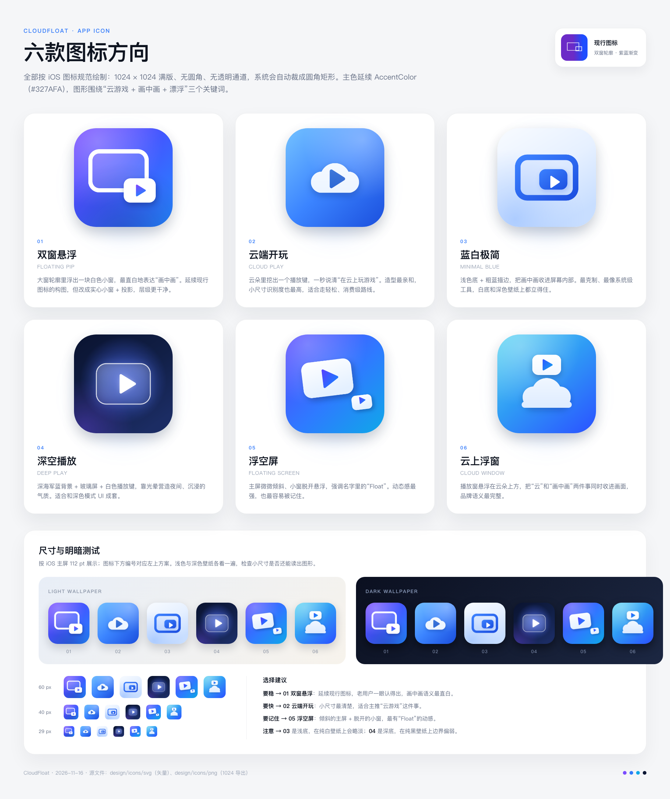

# CloudFloat 图标方案

2026-11-16 · 6 个方向，均为 1024×1024、sRGB、无 alpha 的满版图（系统自动裁圆角）。

| # | 名称 | 文件 | 想传达的气质 |
|---|---|---|---|
| 01 | 双窗悬浮 Floating PiP | `png/01-floating-pip.png` | 延续现行图标，画中画语义最直白 |
| 02 | 云端开玩 Cloud Play | `png/02-cloud-play.png` | 云 + 播放，最亲和、小尺寸最清楚 |
| 03 | 蓝白极简 Minimal Blue | `png/03-minimal-blue.png` | 克制、系统工具感 |
| 04 | 深空播放 Deep Play | `png/04-deep-play.png` | 深色、玻璃、夜间沉浸 |
| 05 | 浮空屏 Floating Screen | `png/05-float-screen.png` | 倾斜 + 脱开的小窗，最有“Float”动感 |
| 06 | 云上浮窗 Cloud Window | `png/06-cloud-window.png` | 云和画中画同时出现，语义最完整 |

## 换成正式图标

1. 选定一款，例如 01。
2. 覆盖 `CloudFloat/Resources/Assets.xcassets/AppIcon.appiconset/AppIcon-1024.png`。
3. `Contents.json` 保持现有的 single-size 1024 配置，不需要自己加圆角或透明边。
4. 重新构建，或在 Xcode 里预览。

注意：App Store 图标不能带 alpha 通道。本目录的 PNG 已扁平化为 RGB；如果从 SVG 重新导出，记得再扁平一次。

## 源文件

- `svg/*.svg`：矢量源文件，改色、改线宽、改圆角都在这里。
- `png/*.png`：由 `rsvg-convert -w 1024 -h 1024` 导出后扁平化（无 alpha）。
- `preview-sheet.html`：对比板源文件，浏览器直接打开；`preview-sheet.png` 是导出的成图。
- `png/00-current.png`：现行图标，仅用于对比。

## 设计约束

- 主色沿用 `AccentColor` `#327AFA`，紫蓝/青蓝渐变作为辅助。
- 不使用文字，最小可读尺寸测到 29 px。
- 所有图标都按 iOS squircle 满版设计，图形留出约 15% 安全边距，避免被系统圆角裁到。
