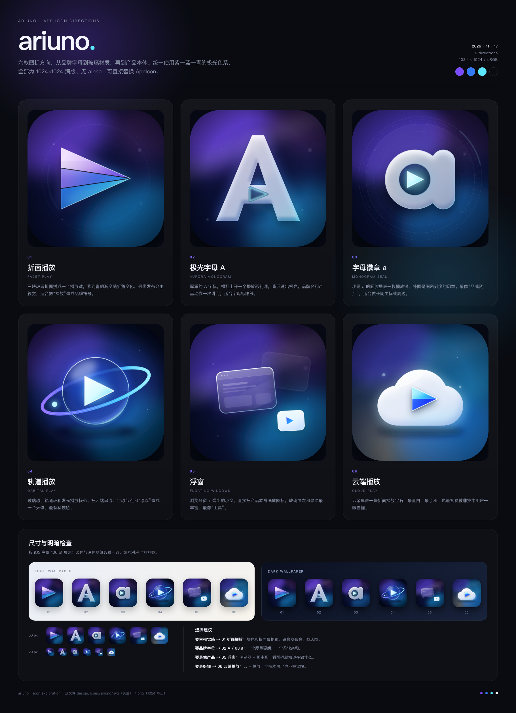

# Ariuno · App 图标方向

2026-11-17 · 6 个方向 · 1024×1024 · sRGB / 无 alpha / 满版（系统自动裁圆角）

> **当前选用：03 字母徽章 a** — 已替换到 `CloudFloat/Resources/Assets.xcassets/AppIcon.appiconset/AppIcon-1024.png`。

| # | 方向 | 文件 | 一句话 |
|---|---|---|---|
| 01 | 折面播放 Facet Play | `png/01-facet-play.png` | 三块玻璃折面拼成播放键，紫→青渐变，最像发布会主视觉 |
| 02 | 极光字母 A Aurora Monogram | `png/02-aurora-a.png` | 厚重 A 字标，横杠开播放形孔洞，背后透极光 |
| 03 | **字母徽章 a Monogram Seal（已选用）** | `png/03-monogram-a.png` | 小写 a 圆腔里嵌播放键，外圈刻度印章，最像品牌资产 |
| 04 | 轨道播放 Orbital Play | `png/04-orbital-play.png` | 玻璃球 + 轨道环 + 发光播放核心，讲云端串流与全球 |
| 05 | 浮窗 Floating Windows | `png/05-floating-windows.png` | 浏览器窗 + 弹出小窗，把产品本身画成图标 |
| 06 | 云端播放 Cloud Play | `png/06-cloud-play.png` | 云 + 折面播放宝石，最直白、最亲和 |

## 怎么换成正式图标

1. 选定一款，例如 01。
2. 覆盖 `CloudFloat/Resources/Assets.xcassets/AppIcon.appiconset/AppIcon-1024.png`。
3. `Contents.json` 保持现有 single-size 1024 配置，不用自己加圆角、透明边或白色底。
4. 重新构建，或在 Xcode 里预览。

App Store 图标不能带 alpha。本目录的 PNG 已是 RGB、无 alpha；如果改 SVG 后重新导出，记得再扁平一次。

## 说明

- 所有图形围绕“播放 / 窗 / 云 / 字母”四类母题，主色统一在紫 `#7B4BFF`、蓝 `#327AFA`、青 `#5BE8FF`。
- 02、03 是字母路线；01、04 是符号路线；05、06 是产品直译路线。可以按品牌阶段选用。
- 05 的浏览器窗是暗色玻璃，在纯白壁纸上对比偏弱；06 的云边缘较软，适合更亲和的消费级定位。
- 每个图标都按 iOS squircle 满版设计，主体留出安全边距；缩到 29 px 仍能读出主形。

## 源文件

- `svg/*.svg`：矢量源文件，所有渐变、滤镜、遮罩都在里面。
- `png/*.png`：1024 导出，已扁平为 RGB。
- `preview-sheet.html`：对比板源文件；`preview-sheet.png` 是导出的成图。

上一版（CloudFloat 时期）的六款方案仍保留在 `design/icons/` 下，可随时对比。
