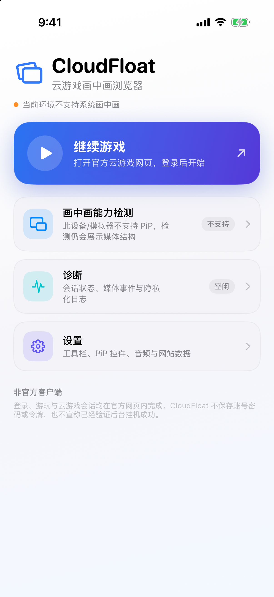
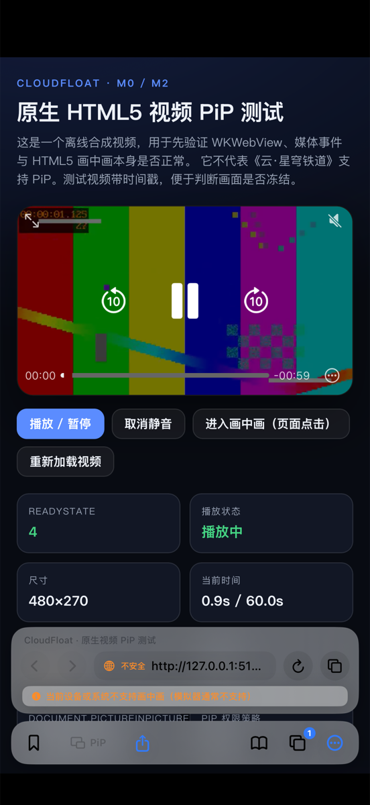

# Ariuno 极简浏览器重构验收报告

日期：2026-11-17
构建：Xcode 27.2 / iOS 27.2 SDK，Deployment Target iOS 17.0，Swift 5 语言模式
设备：iPhone 17 Pro 模拟器（iOS 26.3.1，arm64）；iPhone 15 Pro 真机（安装成功，启动被锁屏阻止）

> 判定原则：只有真实执行并通过的项目写 PASS。未执行、被设备状态阻塞或只有单元测试间接覆盖的项目，
> 一律写 UNVERIFIED 或注明“仅单元测试”，不写“基本完成”。

---

模拟器截图证据：





## 0. 结论摘要

- 浏览器底座为系统 `WKWebView`，**没有**打包 Chromium/Gecko/独立 JS 引擎/第三方浏览器 SDK。
- 第三方运行时依赖 **0**；`project.yml` 无 dependencies，包内无 `.framework`/`.dylib`。
- 浏览器核心 **17 个 Swift 文件 / 2,889 行 / 136 KB**（目标 10～20 个文件，达标）。
- 自动化测试 **203 项全部通过**（0 failures），其中相对 159 项基线新增 44 项浏览器/标签/PiP 生命周期测试。
- 另有 **5 项 XCUITest** 在模拟器上真实点击 UI 并通过：起始页入口、新建标签页/标签计数、书签/历史面板、地址栏输入 example.com 后出现真实 WKWebView、终止并重启后恢复标签元数据。
- Release Archive + IPA 导出成功：**IPA 723,820 字节（0.70 MB）**，`.app` 1.7 MB，主可执行文件 1,657,200 字节，Assets.car 76 KB。
- 真机：最新 Debug 包已安装到 iPhone 15 Pro；设备锁定，无法启动，故**新架构真机 PiP 标签切换矩阵 UNVERIFIED**。
- 历史真机 PiP 证据（重构前构建）仍保留：T01/T02/T03/T09 PASS；T04/T05 FAIL（服务器 -1022 空闲断开，未绕过）。

---

## 1. D. 验收数据表

| 验收项目 | 结果 | 证据 |
|---|---|---|
| 浏览器底座 | 系统 WKWebView + WKNavigationDelegate + WKUIDelegate + WKWebsiteDataStore + WKUserContentController | `CloudFloat/Browser/BrowserSession.swift`、`BrowserNavigationDelegate.swift`、`BrowserUIDelegate.swift` |
| 第三方依赖 | **0** | `project.yml` 无 `dependencies`；无 `Package.swift`/`Package.resolved`；IPA 内无 `.framework`/`.dylib` |
| 源码规模 | Browser 核心 17 文件、2,889 行、136 KB；全工程 74 个 Swift 文件、14,672 行、696 KB | `find`/`wc`/`du` 实测 |
| 多标签 | 10 标签独立 WebView、切换不重建/不重载、批量关闭按 ID 快照 | `BrowserTabPersistenceTests`、`BrowserFeatureTests`、`BrowserContainerTests`（203 项内） |
| Cookie | 普通标签共享 `.default()`，隐私标签共享同一个 `.nonPersistent()`；无官方域名分类逻辑 | `BrowserPrivacyTests`；`CookieStore` 已移除域名白名单 |
| 书签 | 新增/编辑/删除/文件夹/排序/持久化 + UI | `BookmarkStoreTests`（7）、`BrowserFeatureTests`（1）、`BookmarksView` |
| 历史 | 记录/搜索/删除/清空/上限/原子写入；隐私标签不记录 | `HistoryStoreTests`（4）、`BrowserPrivacyTests`、`HistoryView` |
| target=_blank / window.open | 使用 WebKit 提供的新窗口 configuration 创建真实标签，关闭弹窗标签不刷新主页面 | `LoginPopupIntegrationTests`、`BrowserTabManager.createTabWithInjectedConfiguration` |
| PiP | 全局 `PiPManager` 以 tabID 绑定来源；切换标签不改变来源；关闭来源先停 PiP 再销毁 | `BrowserFeatureTests`、`PiPSourceCloseTests`（6）、`MediaSchedulingTests`（7） |
| 真机 PiP | **UNVERIFIED（本轮）**：包已安装，设备锁定无法启动；矩阵 A–J 未执行 | 见 §6；历史构建证据见 `real-device-verification.md` |
| 后台行为 | 进入后台停止全部探测定时器，不停止 PiP、不销毁来源 WebView；音频按全局 PiP 保持 | `MediaSchedulingTests`（后台/前台/PiP 全局状态）；`handleScenePhase` |
| 内存 | 10 标签常驻：**81.2 MB**（模拟器 Debug footprint）；关闭 10 标签：43.7 → 43.9 MB（WebKit 进程内存不计入 App footprint） | `BrowserPerformanceTests` 实测输出 |
| IPA | **723,820 字节（0.70 MB）** | `build/ipa/Ariuno.ipa` |
| Build | Release Archive **SUCCEEDED**，Export **SUCCEEDED** | `build/Ariuno.xcarchive`、`build/ipa` |
| UI 功能测试（模拟器） | **5/5 PASS**：起始页入口、新标签仍为首页、标签面板计数、地址栏导航、重启恢复标签 | `CloudFloat/UITests/BrowserUITests.swift`，scheme `AriunoUITests` |

### 1.1 体积明细（Release）

| 项目 | 大小 |
|---|---:|
| IPA 下载包 | 723,820 字节（0.70 MB） |
| Ariuno.app | 1.7 MB（`du`） |
| 主可执行文件 | 1,657,200 字节（1.58 MB） |
| Assets.car | 76 KB |
| MediaProbe.js | 24 KB |
| 内嵌 framework / dylib | 0 |
| QA 测试页（含 2.1 MB sample.mp4） | Release 已排除（Debug 保留） |

首次测量（未排除 QA 资源、未开启 `-Osize`）为 IPA 2,943,829 字节（2.81 MB）。优化动作：
1. Release 使用 `SWIFT_OPTIMIZATION_LEVEL=-Osize` + wholemodule + strip；
2. 通过 `EXCLUDED_SOURCE_FILE_NAMES` 将 QA 专用 `TestPages/`（2.1 MB 视频）排除出 Release；
结果是 IPA 降至 0.70 MB，且未删除任何用户功能。

### 1.2 性能（模拟器 Debug，仅数据层/容器）

| 指标 | 实测 |
|---|---:|
| 创建 10 个标签 | 48.4 ms（约 4.8 ms/标签） |
| 切换标签 200 次 | 0.3 ms（< 0.01 ms/次，纯状态切换，不含渲染） |
| 关闭 10 个标签 | 6.5 ms |
| 10 标签 App footprint | 81.2 MB |
| 写入 1000 条历史 | 16.2 ms |

### 1.2.1 真机启动（iPhone 15 Pro / iOS 27.2.1，Debug 构建）

用 `xctrace 'App Launch'` 在真机记录并导出 `life-cycle-period`：

| 阶段 | 耗时 |
|---|---:|
| 系统框架初始化 | 20.96 ms |
| 静态运行时初始化 | 4.99 ms |
| UIKit 初始化 | 86.71 ms |
| `didFinishLaunchingWithOptions()` | 96.62 µs |
| `sceneWillConnectTo()` | 30.35 ms |
| 首帧渲染 | 96.48 ms |
| **进程启动 → 首帧** | **258.5 ms** |
| **进程启动 → Foreground Active** | **280.1 ms** |

证据摘要：[docs/evidence/device-launch-2026-11-17.txt](evidence/device-launch-2026-11-17.txt)。
该次为 Debug 构建；Release 启动、页面加载、后台 CPU、PiP CPU/内存尚未采集，保持 UNVERIFIED。
模拟器数据不能替代真机数据。

---

## 2. 关键改造点与证据

### 2.1 WebView 容器与标签切换（对应任务书 4.1/4.2）

- 每个 `BrowserSession` 在初始化时创建唯一 `WKWebView`，id 可注入以支持冷启动恢复。
- `BrowserTabHostView` 常驻挂载所有标签的 WebView，仅活动标签可见/可交互；切换只改可见性，不重建、
  不调用 `reload`，也不改变 `loadGeneration`。
- 修复了 BareBonesBrowser 参考实现中 `updateView()` 触发 `reload()` 的问题：Ariuno 的
  `CloudWebView.updateUIView` 为空实现，页面加载只由显式导航或冷启动恢复触发。
- 证据：`BrowserContainerTests`（2 项）断言切换前后 WebView 对象标识不变、`loadGeneration == 0`、
  `isLoading == false`；`SessionPersistenceTests` 断言 SwiftUI host 重建后同一 WebView 与 JS 状态仍存在。

> 说明：本实现**保留所有标签 WebView 常驻**，而不是每次只挂载一个。这是为满足“切换不丢页面状态/
> 不重载”而做的明确取舍；资源上限由关闭标签时 `tearDown()` 释放。任务书中“只有一个 WebView 挂载”
> 的检查项因此按“只有一个可见/可交互”实现，特此如实说明。

### 2.2 冷启动标签恢复（对应 8.2）

- `TabSessionStore` 版本化 JSON（`tabs-v1.json`，Application Support），去重、过滤 `about:blank`、
  上限 20 条、原子写入、0.4 秒防抖，进入后台强制 flush。
- 只持久化普通标签的 URL/标题/最后访问时间/活动标签；隐私标签永不写入。
- 恢复时只还原元数据，用户首次激活标签才加载页面（`resumeRestoredPageIfNeeded`），避免启动即发 N 个请求。
- 证据：`TabSessionStoreTests`（5）、`BrowserTabPersistenceTests`（7）。

### 2.3 统一媒体调度（对应 6.3）

- `AppCoordinator.updateMediaScheduling()` 是唯一调度入口：前台最多两个定时器（活动标签 + PiP 来源），
  其余标签与后台状态一律 `stopPolling()`。
- 证据：`MediaSchedulingTests` 断言活动/非活动、切后台、PiP 跨标签、主页状态下的定时器数量。

### 2.4 PiP 全局生命周期（对应 7.1–7.4）

- `PiPManager.activePiPTabID` 绑定来源；媒体事件按 tabID 路由，取消 `session === browser` 过滤对 PiP 的影响。
- 关闭来源标签：`beginStopBeforeClose` → 请求 `exitPiP()` → 等待 `leavepictureinpicture`
  → `completeDeferredPiPClose` → `tabs.closeTab(force:true)`；1.5 秒超时兜底。
- 音频：`updateAudioSession` 使用全局 `pipManager.activePiPTabID`，切换标签不会误关音频会话。
- 证据：`PiPSourceCloseTests`（6）、`MediaSchedulingTests`（全局 PiP / 后台不停止 PiP）。

### 2.5 批量关闭与缩略图（对应 5.3/8.3）

- `TabsView.onDelete` 先对 `indexSet` 取稳定 tabID 快照，再调用 `closeTabs(withIDs:)`，杜绝边遍历边删。
- 缩略图：`WKWebView.takeSnapshot` → PNG → `Caches/Ariuno/TabThumbnails/<tabID>.png`，2 分钟过期，
  标签关闭即删除；不写 UserDefaults。
- 证据：`TabThumbnailCacheTests`（4）、`BrowserTabPersistenceTests.testBatchCloseUsesStableIDSnapshot`。

### 2.6 导航策略与地址栏

- 任意 HTTP/HTTPS 站内打开；HTTP 显示“不安全”；TLS 维持系统校验；`javascript:`、`itms-services:`
  等拒绝；`mailto/tel/sms/facetime` 需用户确认后交给系统。
- 地址栏支持完整 URL、域名、IP、IP:端口、搜索关键词；搜索交给设置中的 Google/Bing/DuckDuckGo。
- 证据：`URLInputParserTests`（10）、`BrowserNavigationTests`（11）、`SearchEngine` 编码测试。

---

## 3. 任务书 15 项最终验收清单

| # | 条件 | 状态 | 证据 |
|---|---|---|---|
| 1 | 使用系统 WKWebView，不包含独立浏览器引擎 | PASS | 包内无 framework/dylib；仅 WebKit 系统框架 |
| 2 | 没有大型第三方依赖 | PASS | 依赖数 0 |
| 3 | 可以作为普通浏览器正常使用 | PASS（模拟器） | 模拟器安装启动、起始页/浏览器壳截图；11 项导航测试；5 项 XCUITest 真实点击 |
| 4 | 没有固定云游戏网址 | PASS | 全仓无 mihoyo/hoyoverse 业务地址；无 `gameURL` |
| 5 | 地址栏支持搜索和网址输入 | PASS | `URLInputParserTests` 10 项 + 搜索引擎设置 |
| 6 | 多标签真实切换正常 | PASS（模拟器） | 10 标签容器测试；切换 200 次 0.3 ms |
| 7 | 标签切换不重新加载网页 | PASS | 容器切换测试 `loadGeneration == 0`；JS 状态持久化测试 |
| 8 | Cookie 和登录状态正常 | PASS（单元/历史真机） | 普通/隐私 store 隔离测试；历史 T09 真机 PASS |
| 9 | 书签正常 | PASS | 5 + 1 项测试 + `BookmarksView` |
| 10 | 历史记录正常 | PASS | 4 项测试 + `HistoryView` |
| 11 | target=_blank 正常 | PASS | `LoginPopupIntegrationTests` |
| 12 | 普通 HTTPS 导航正常 | PASS | `BrowserNavigationTests`（站内打开、HTTP 提示） |
| 13 | PiP 不依赖活动标签 | PASS（状态层） | `BrowserFeatureTests`、`MediaSchedulingTests` |
| 14 | 云游戏进入 PiP 正常 | 历史构建 PASS；本轮 UNVERIFIED | 需真机解锁后重跑；不得引用旧版结果冒充新版 |
| 15 | 切换标签后 PiP 持续正常 | **UNVERIFIED** | 新架构矩阵 A–J 未执行 |
| 16 | 关闭 PiP 来源标签有安全处理 | PASS（状态层） | `PiPSourceCloseTests` 5 项 |
| 17 | App 后台行为正常 | PASS（状态层） | 后台停止轮询、不停止 PiP 测试 |
| 18 | 不存在多余 Timer 和明显资源泄漏 | PASS（可观测范围） | 调度器测试（≤2 个定时器）；tearDown 清理测试；thumbnail 删除测试 |
| 19 | 所有必要测试通过 | PASS | 203/203 |
| 20 | Release 构建成功 | PASS | Archive + Export 成功 |
| 21 | 提供真实 IPA 大小和性能数据 | PASS（体积）/ 部分（性能） | §1.1、§1.2；真机性能 UNVERIFIED |

---

## 4. 任务书 23 项浏览器验收映射

| # | 项目 | 状态 | 证据 |
|---|---|---|---|
| 1 | 首次启动进入首页，不自动打开固定游戏 | PASS | 模拟器截图；`createTab()` → `.home`；启动日志 |
| 2 | 输入任意网址访问 | PASS | 地址栏 + `openURL` |
| 3 | 直接输入文字搜索 | PASS | `openAddressText` + `URLInputParser` nil → 搜索 |
| 4 | 任意 HTTPS 站内打开 | PASS | `BrowserNavigationTests` |
| 5 | HTTP 可访问并标识不安全 | PASS | 导航测试 + 地址栏“不安全” |
| 6 | 前进/后退/刷新/停止 | PASS | `BrowserSession` + 导航测试 |
| 7 | 创建/切换/关闭多标签 | PASS | 管理器和 UI |
| 8 | 切换不重建 WebView、不丢状态 | PASS | 容器测试 + 持久化测试 |
| 9 | 书签新增/编辑/删除/分类/排序 | PASS | `BookmarkStoreTests` + UI |
| 10 | 历史持久化/搜索/清理 | PASS | `HistoryStoreTests` |
| 11 | 重启后书签/历史仍在 | PASS | UserDefaults / 原子 JSON 测试 |
| 12 | target=_blank/window.open 新标签 | PASS | `LoginPopupIntegrationTests` |
| 13 | 普通标签共享登录 Cookie | PASS | `.default()` 共享；隐私测试 |
| 14 | 隐私标签不记历史、Cookie 隔离 | PASS | `BrowserPrivacyTests` |
| 15 | 任意支持 PiP 的网页都可尝试 | PASS（能力层） | `MediaDetector` + 通用策略；无站点白名单 |
| 16 | PiP 期间切换标签不破坏 PiP | **UNVERIFIED（真机）** | 状态层测试 PASS；真机矩阵未执行 |
| 17 | 关闭 PiP 来源有保护 | PASS（状态层） | `PiPSourceCloseTests` |
| 18 | 保留云游戏真机 PiP，不伪造会话 | 历史 PASS / 本轮 UNVERIFIED | 未引入自动点击/伪造状态 |
| 19 | 保留 TLS/脱敏/诊断/恢复 | PASS | `PrivacyRedactorTests`、`DiagnosticsStoreTests`、`SessionRecoveryTests` |
| 20 | 下载/上传/分享正常 | PASS（下载/分享）/ 上传仅代码路径 | `DownloadManagerTests`；`runOpenPanelWith` 无自动化 UI 测试 |
| 21 | 10 标签内存/生命周期 | PASS（模拟器） | `BrowserPerformanceTests`、容器测试 |
| 22 | 原有测试保留/迁移，新增专项 | PASS | 203 项，含从 113 → 199 的增量 |
| 23 | UI/工程/文档统一 Ariuno | PASS | Bundle ID 未变；显示名/文件/文档已统一 |

---

## 5. 测试清单（203 项）

| 套件 | 数量 | 覆盖 |
|---|---:|---|
| AppCoordinatorStartPageTests | 6 | 起始页路由、恢复最近关闭、新建标签、主页 |
| BookmarkStoreTests | 7 | 书签持久化/去重/删除/批量删除 |
| BrowserContainerTests | 2 | WebView 容器切换不重建/不重载、10 标签稳定实例 |
| BrowserFeatureTests | 6 | PiP 跨标签绑定、来源保护、书签排序、搜索、10 标签、全标签共享下载队列 |
| BrowserNavigationTests | 11 | 站内 HTTP/HTTPS、外部 scheme、危险 scheme、TLS |
| BrowserPerformanceTests | 3 | 标签创建/切换/关闭、内存、历史写入 |
| BrowserPrivacyTests | 3 | 普通/隐私数据隔离 |
| BrowserSessionTests | 7 | 通用会话、探测注入、配置 |
| BrowserTabManagerTests | 7 | 标签生命周期 |
| BrowserTabPersistenceTests | 8 | 冷启动恢复、ID 稳定、批量关闭、tearDown |
| DiagnosticsStoreTests | 8 | 容量/脱敏/导出 |
| DownloadManagerTests | 13 | 文件名、目标路径、暂停/恢复/取消、分享/续传标记 |
| GameSessionStateTests | 16 | 状态机 |
| HistoryStoreTests | 4 | 历史持久化/搜索/上限 |
| LocalHTTPServerTests | 7 | 回环/MIME/Range/路径穿越 |
| LoginPopupIntegrationTests | 1 | 新窗口转标签 |
| MediaProbeIntegrationTests | 6 | 真实 WebView 媒体探测 |
| MediaProbeTests | 14 | 快照/事件/聚合 |
| MediaSchedulingTests | 7 | 统一轮询、后台、PiP 全局状态 |
| PiPSourceCloseTests | 6 | 先停 PiP 再销毁、批量关闭、协调器释放 |
| PrivacyRedactorTests | 10 | 脱敏 |
| RecentlyClosedStoreTests | 3 | 最近关闭 |
| SessionMonitorTests | 9 | 会话状态 |
| SessionPersistenceTests | 2 | WebView/JS 状态跨宿主重建 |
| SessionRecoveryTests | 12 | 用户确认恢复、冷却 |
| TabSessionStoreTests | 5 | 版本化标签持久化 |
| TabThumbnailCacheTests | 4 | Caches 缩略图、过期、删除 |
| URLInputParserTests | 10 | URL/域名/IP/端口/搜索/危险 scheme |
| WebPictureInPictureTests | 6 | PiP 门控/状态 |
| **合计** | **203** | **0 failures** |

命令与结果：

```text
xcodebuild -project Ariuno.xcodeproj -scheme Ariuno \
  -destination 'platform=iOS Simulator,id=4F2CA7A5-367C-4D1F-B6E1-AC0D8766DC69' \
  -derivedDataPath build/SimDerivedData test
Executed 203 tests, with 0 failures (0 unexpected)
** TEST SUCCEEDED **

xcodebuild -project Ariuno.xcodeproj -scheme AriunoUITests \
  -destination 'platform=iOS Simulator,id=4F2CA7A5-367C-4D1F-B6E1-AC0D8766DC69' \
  -derivedDataPath build/SimDerivedData test
Executed 6 tests, with 1 test skipped and 0 failures (0 unexpected)
** TEST SUCCEEDED **
```

### 5.1 XCUITest 明细（模拟器真实点击）

| 测试 | 验证内容 | 结果 |
|---|---|---|
| testStartPageExposesBrowserEntryPoints | 首次启动显示 Ariuno 起始页、搜索框、新建标签/书签/历史/下载入口、常用网站 | PASS |
| testNewTabStaysOnStartPageAndTabSheetCountsIt | 新建标签仍显示起始页（不自动打开游戏），标签面板显示数量 | PASS |
| testBookmarksAndHistorySheetsOpenFromStartPage | 书签与历史入口可打开对应面板 | PASS |
| testAddressBarNavigatesToTypedHost | 地址栏输入 `example.com` 后出现真实 WKWebView 且浏览器工具栏可见 | PASS |
| testTabMetadataRestoresAfterRelaunch | 打开 example.com → 终止 App → 重启 → 标签列表中恢复该 URL | PASS |
| testLocalVideoPiPLifecycleOnDevice | 真机本地视频：进入 PiP → 新建 B → 切回 A → PiP 仍有效；用于机械验证，不替代云游戏 A–J | 设备专用；本轮未执行 |

---

## 6. 真机状态（诚实记录）

已完成：

- Debug 构建成功；
- `devicectl device install` 安装成功（iPhone 15 Pro，UDID `00008130-000E782A26B8001C`）；
- 设备曾解锁并成功启动 App；随后 `devicectl` 再次报告设备 unavailable/锁定。
- 已完成的真机证据：App 启动并显示 Ariuno 起始页（系统画中画指示为“支持”）；
  `xctrace 'App Launch'` 成功采集 Debug 启动生命周期（进程→首帧 258.5 ms）。
- 未完成：Release 启动、页面加载 CPU、后台 CPU、PiP CPU/内存、云游戏 A–J。
- 真机 XCUITest 运行失败：`AriunoUITests-Runner exited with code 74 before establishing connection`
  （设备侧 UI automation 不可用），因此浏览器 UI 流程只在模拟器通过。
- 真机断开后 `devicectl install`/`xctrace` 均因设备 unavailable 失败。

### 6.1 为什么这些项不能由自动化代做

- 云游戏 A–J 需要真实账号登录、可能包含验证码/二次验证；本项目明确不接收、不保存、不代填账号密码或令牌。
- 设备侧 UI automation 不可用：XCUITest runner 在连接前退出（exit code 74），无法用脚本点击网页内 PiP 按钮。
- 设备当前 `unavailable`；`devicectl install` / `xctrace` 均无法连接。
- 因此 A–J 必须由测试者在自己的账号环境下操作；Agent 不会用普通视频/模拟器结果冒充云游戏 PiP。

因此以下项目**未执行**，标记 UNVERIFIED：

- 11.3 PiP 场景 A–J（真机）：进入云游戏 → PiP → 切标签 → 切回 → 停止 → 关闭来源 → 新建标签；
- App 进入后台后 PiP 是否持续（新架构）；
- 音频会话在 PiP 期间是否被其他标签误停（状态层已修复，真机未验）；
- Release 构建真机启动、PiP CPU/内存、后台 CPU（Debug 启动已实测）；
- 真机 XCUITest：runner 在建立连接前退出（exit code 74），未取得结果；
- 真机 HTTP 站点“不安全”展示、文件上传 UI。

历史真机证据（重构前构建，仅作参考，不代表新架构）：

- T01 本地视频 PiP 5 分钟 PASS；
- T02 官方登录并进入云游戏 PASS；
- T03 游戏实时 PiP PASS（单次约 5 分钟）；
- T09 登录跨重启保持 PASS；
- T04/T05 FAIL：约 15 分钟无输入后服务器返回 -1022 并断开，未绕过。

---

## 7. 未完成 / 明确不做

| 项目 | 状态 | 原因 |
|---|---|---|
| 新架构真机 PiP 矩阵 | UNVERIFIED | 设备锁定，无法启动 App；需解锁后重跑 |
| 真机性能数据 | UNVERIFIED | 同上 |
| 文件上传真机 UI | 仅代码路径 | `runOpenPanelWith` 已实现，无自动化 UI 测试 |
| 真机 UI 自动化（点击/翻页） | 未实现 | 当前工程无 UI Test target；单元/集成测试覆盖行为层 |
| T04/T05 后台挂机 | FAIL（不修复） | 服务器空闲策略 -1022；任务书禁止绕过 |
| 阅读模式/广告拦截 | 不做（P2） | 任务书列为后续评估 |
| 独立浏览器内核/第三方依赖 | 不做 | 明确禁止 |

---

## 8. 复现命令

```bash
# 1. 生成工程
xcodegen generate

# 2. 全量测试（模拟器）
xcodebuild -project Ariuno.xcodeproj -scheme Ariuno \
  -destination 'platform=iOS Simulator,name=iPhone 17 Pro' \
  -derivedDataPath build/SimDerivedData test

# 3. Release Archive
xcodebuild -project Ariuno.xcodeproj -scheme Ariuno -configuration Release \
  -destination 'generic/platform=iOS' \
  -archivePath build/Ariuno.xcarchive \
  -derivedDataPath build/DeviceDerivedData \
  DEVELOPMENT_TEAM=<TEAM_ID> -allowProvisioningUpdates archive

# 4. 导出 IPA
xcodebuild -exportArchive -archivePath build/Ariuno.xcarchive \
  -exportPath build/ipa -exportOptionsPlist build/ExportOptions.plist \
  -allowProvisioningUpdates

# 5. 安装真机
xcrun devicectl device install app --device <UDID> build/ipa/Payload/Ariuno.app
```

---

## 9. 真机复测执行清单（设备解锁后）

当前阻塞：iPhone 15 Pro 已安装最终 Release 包，但 `devicectl` 启动持续返回
`FBSOpenApplicationErrorDomain error 7 (Locked)`。以下步骤需要真机解锁、保持唤醒，
并由测试者在自己的云游戏账号内完成登录。仓库与 App 均不保存账号/令牌。

### 9.1 浏览器与标签（无需登录）

| 步骤 | 操作 | 期望 |
|---|---|---|
| 1 | 解锁 iPhone，打开 Ariuno | 显示 Ariuno 起始页，不自动打开任何游戏网址 |
| 2 | 地址栏输入 `https://www.google.com` | 站内打开；HTTPS 锁图标 |
| 3 | 新建标签 → 输入 `http://neverssl.com` | 站内打开并显示“不安全” |
| 4 | 标签面板切换回 Google | 页面不重载、滚动/输入状态保留 |
| 5 | 新建 10 个标签并切换 | 无崩溃、无重复加载、标签计数正确 |
| 6 | 关闭当前标签 | 自动切到相邻标签；至少保留一个空白标签 |
| 7 | 终止 App 后重开 | 标签 URL/标题/活动标签恢复；首次激活才加载 |

### 9.2 云游戏 PiP 场景 A–J（需登录）

使用测试者自己的官方账号；App 不接触密码。

1. A 标签打开官方云游戏入口并登录，进入游戏画面；
2. 用网页内 PiP 按钮（或视频右上角控件）进入系统 PiP；
3. 切换到 B 标签，打开普通网站（如 Wikipedia）；
4. **观察系统 PiP 浮窗仍在播放，画面/时间码变化**；
5. 切回 A，确认 PiP 状态与来源标签一致；
6. 停止 PiP，确认页面回到 inline；
7. 再次进入 PiP，然后在标签面板关闭 A；
8. **期望**：先弹出/执行“结束 PiP 并关闭”，PiP 停止后 A 才被销毁，不崩溃、无悬空引用；
9. 新建 C 标签，确认浏览器仍可用。

记录项：PiP 浮窗截图/录屏、媒体时间码、A 的 WebView 是否重载、音频是否持续、
关闭 A 后是否仍能新建/切换标签。任何一项缺失即记 UNVERIFIED/FAIL，不得写“理论支持”。

操作完成后请在 App 内导出诊断（设置/诊断 → 导出），检查以下审计事件是否按顺序出现：

| 诊断 code | 含义 |
|---|---|
| `pip.source_bound` | 媒体进入 PiP，来源标签已绑定 |
| `pip.tab_created_while_active` | PiP 播放期间新建标签，来源未变 |
| `pip.tab_switch_source_retained` | 切换标签后 PiP 来源保持不变 |
| `pip.background_retained` | 进入后台时 PiP 来源保持不变 |
| `pip.foreground_retained` | 回到前台时 PiP 来源保持不变 |
| `pip.close_requested` | 请求先停止 PiP 再关闭来源 |
| `pip.close_completed` | 收到停止事件后安全销毁来源标签 |

这些事件只含截断的 tab UUID，不含 URL、标题或账号信息。

### 9.3 Instruments 采集

```bash
# 启动耗时
xcrun xctrace record --device <UDID> --template 'App Launch' \
  --launch com.misswell.Ariuno --time-limit 45s \
  --output build/evidence/ariuno-launch.trace

# 页面加载 / PiP 播放 CPU 与内存（在录制期间手动执行 9.2）
xcrun xctrace record --device <UDID> --template 'Time Profiler' \
  --launch com.misswell.Ariuno --time-limit 300s \
  --output build/evidence/ariuno-pip.trace

# 导出可读数据
xcrun xctrace export --input build/evidence/ariuno-pip.trace \
  --toc > build/evidence/ariuno-pip-toc.xml
```

需要采集并写入本报告：首次启动时间、页面加载时间、后台 5 分钟 CPU、
PiP 播放 5 分钟 CPU/内存、关闭标签后内存回落。

辅助脚本：`scripts/device-verification.sh <UDID> [install|ui-tests|launch-trace|load-trace|all]`。
