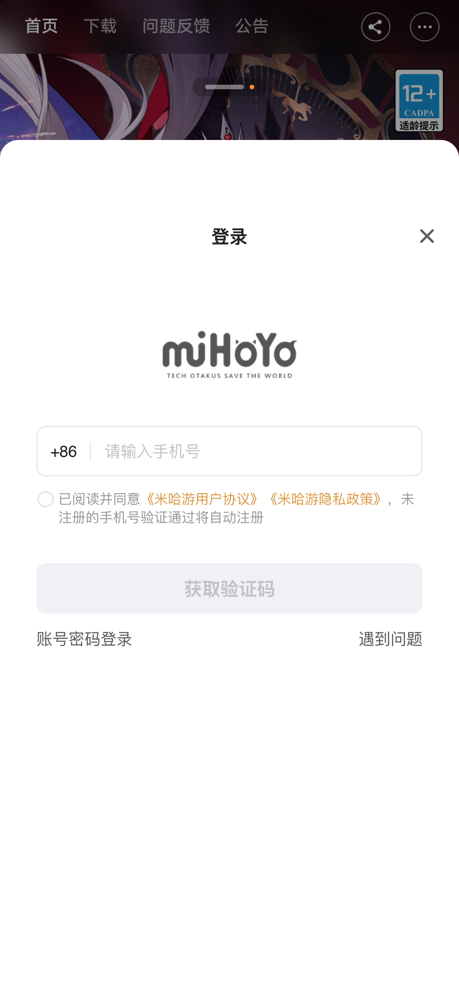
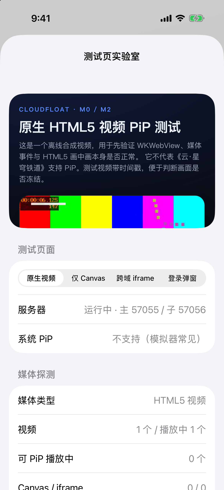

# M0 可行性验证报告（CloudFloat）

- 报告日期：2026-11-16
- 结论先行：**真机已能官方登录、进入云游戏、出现游戏实时 PiP，并观察到自动战斗推进；但后台无输入约 15 分钟后，游戏服务器主动断开（“长时间未操作游戏，已中断连接”，错误码 -1022），T04/T05 FAIL。因此不得宣称后台挂机，最终交付应为浏览器 + 诊断原型。**
- M0 状态：**入口/登录/进入游戏/游戏实时 PiP 通过（单次）；后台 1/5/15/30 分钟与自动战斗持续 FAIL（服务器空闲策略）。**
- 验证过程：先在模拟器完成浏览器/探测/状态机验证（[simulator-verification.md](simulator-verification.md)），随后在 iPhone 15 Pro 真机完成本地视频 PiP、官方登录、进入游戏、游戏自动战斗 PiP；详细证据见 [real-device-verification.md](real-device-verification.md)。
- 范围状态：用户已于 2026-11-16 明确接受“浏览器 + 诊断原型”的缩小范围（[scope-acceptance.md](scope-acceptance.md)）；原任务完整验收未达成，T04/T05 保持 FAIL，不宣称后台挂机。



> 上图仅证明未登录入口壳与登录面板能在该模拟器 WKWebView 中显示；没有输入任何账号、密码或验证码，也没有证明登录后能进入云游戏或产生媒体流。

## 1. 验证边界

本报告遵循任务书第 1 节的不可更改边界：

1. 登录、操作、连接游戏均走官方网页，默认入口 `https://sr.mihoyo.com/cloud/`。
2. 不采集、不保存、不打印账号密码、Cookie 值、HttpOnly 内容或完整带 token 的 URL。
3. 不要求游戏自动开始下一轮战斗，不制作自动点击脚本，不绕过服务器空闲超时。
4. 不使用私有 API、静音音频保活、位置/VoIP 伪后台、后台截图转视频，不绕过米哈游登录/反作弊/授权机制。
5. iOS 系统 PiP 小窗通常不能直接操作游戏，必须点小窗返回 App。
6. 若官方网页不兼容 WKWebView、媒体不可 PiP 或后台被挂起，必须如实展示“不支持/待验证/无法后台维持”。

## 2. 实际环境

| 项目 | 值 |
|---|---|
| 主机 | macOS Darwin 27.2.0，arm64 |
| Xcode | 27.2（Build 27B52） |
| Swift | 6.4.2（工程使用 Swift 5 语言模式） |
| iOS SDK | 27.2 |
| 模拟器 | iPhone 17 Pro，iOS 26.3.1（arm64） |
| 真实 iPhone | **iPhone 15 Pro（iPhone16,1），iOS 27.2.1** |
| 米哈游官方账号 | 用户自有授权账号；用户自行在官方网页登录，助手未读取/记录凭证 |
| 网络 | Wi-Fi（私有网络）+ 5G 蜂窝；系统显示 VPN 已连接；公开 HTTP 探测与真机页面加载均可用 |
| 系统 PiP | 模拟器 `AVPictureInPictureController.isPictureInPictureSupported() == false` |

真实设备的 Safari / WKWebView 对比、真机 PiP、后台行为与游戏进度均未执行。

## 3. 已实际执行的检查

### 3.1 构建与自动化测试

```bash
xcodegen generate
xcodebuild -project CloudFloat.xcodeproj -scheme CloudFloat -configuration Debug \
  -destination 'platform=iOS Simulator,id=4F2CA7A5-367C-4D1F-B6E1-AC0D8766DC69' \
  -derivedDataPath build/DerivedData test
```

结果：**130 tests, 0 failures, TEST SUCCEEDED**（2026-11-16）。测试覆盖：

- `MediaProbeIntegrationTests`：本地 `native-video.html` 的 WKWebView 脚本消息、媒体播放事件、Canvas 分类、跨域 iframe 独立上报、禁用页面内控件；
- `LoginPopupIntegrationTests`：本地登录弹窗样例能打开 Popup WKWebView，关闭弹窗不重建/刷新主 WebView；
- `LocalHTTPServerTests`：回环 HTTP、MIME、Range、404、路径穿越不被 200 服务；
- `GameSessionStateTests` / `SessionMonitorTests` / `SessionRecoveryTests`：状态机、前后台、网络、崩溃、无自动重载；
- `BrowserNavigationTests`：官方域名/第三方认证/外部 URL/危险 scheme/TLS 错误分类；
- `PrivacyRedactorTests` / `DiagnosticsStoreTests`：脱敏、容量、导出；
- `BrowserSessionTests` / `WebPictureInPictureTests`：M1 配置、探测脚本注入、平台/配置/探测门控、M4 接口；
- `SessionPersistenceTests`：T09 跨 BrowserSession 的 WebKit Cookie 持久化；T11 SwiftUI host 重建/首页往返后同一 WebView 与页面 JS 状态。

完整清单见 [qa-matrix.md](qa-matrix.md) 和 [implementation-report.md](implementation-report.md)。

### 3.2 官方入口的未登录静态 HTTP 探测

执行了只读、无凭证的请求：

```bash
curl -sS -o /dev/null -L -w '%{http_code} %{url_effective}\n' https://sr.mihoyo.com/cloud/
curl -sS https://sr.mihoyo.com/cloud/ -o /tmp/cf_probe.html
```

观察（仅代表本机网络与未登录状态）：

| 项目 | 观察值 |
|---|---|
| HTTP 状态 | 200 |
| Content-Type | `text/html; charset=utf-8` |
| 响应体大小 | 5,111 bytes |
| `<title>` | 云·星穹铁道 |
| 静态 HTML 中 `<video>` | 0 |
| 静态 HTML 中 `<canvas>` | 0 |
| 静态 HTML 中 `<iframe>` | 0 |
| `<script>` 标签 | 14 |
| 可见文本 | “加载中”“doesn't work properly without JavaScript enabled” 等壳文本 |
| 关键脚本主机 | `webstatic.mihoyo.com`（含 clgm-web-app、account-sdk 等；未记录完整带参数 URL） |

**不能由该静态探测推断**：登录后的页面结构、视频/Canvas/WebRTC/DRM 类型、是否可 PiP、后台是否持续。入口是一个 JavaScript 运行时壳，真正的媒体路径必须在登录并进入云游戏后由 Web Inspector/探测脚本观察。

### 3.3 官方入口在 WKWebView（模拟器）中的未登录加载

通过 Debug 启动参数 `-CFOpenOfficialEntry` 在 App 的真实 `BrowserSession`/`WKWebView` 中加载官方入口。观察：

- 页面加载完成，会话状态显示“页面就绪”；
- 显示官方登录面板（手机号 + 验证码 / 账号密码登录）；
- 未输入任何账号、密码、验证码；
- 未观察到媒体播放（未登录，理所当然）；
- 页面内媒体探测没有发现可播放 video（登录前 shell 无媒体）；
- 模拟器阶段未验证登录/媒体；随后在真机完成官方登录并进入游戏（用户自行输入凭证），详见 [real-device-verification.md](real-device-verification.md)。真机 Safari 与 WKWebView 的同机对照仍未做。

截图：[images/official-entry-wkwebview.png](images/official-entry-wkwebview.png)。

该结果只说明：**在 iOS 26.3.1 模拟器的 WKWebView 中，官方入口壳没有在登录面板之前被直接拒绝**。它不等于官方页面完整支持 WKWebView，也不等于云游戏可玩。

### 3.4 离线媒体测试页（模拟器）

通过 App 内“测试页实验室”实际加载了内置测试页。截图：



观察：

- `native-video.html`：合成 H.264/AAC 测试视频播放，自带时间码（截图可见 00:00:24.583）；探测到 `video 1 / 播放中 1`；
- 模拟器 `AVPictureInPictureController.isPictureInPictureSupported()` 为 false，页面的 HTML5 PiP 支持检测也显示“不支持”，所以系统 PiP 浮窗无法在模拟器验证；
- `canvas-only.html`：探测到 Canvas，无 video；
- `nested-iframe.html`：两个不同回环端口提供父子页面；集成测试确认父/子 frame 分别上报，子 frame 的视频可被探测；
- `login-popup.html`：集成测试确认 Popup 被承载；关闭弹窗后主 WebView 实例不变、主页面不刷新。

这些验证的是本项目的探测与浏览器管线，不是官方游戏支持 PiP 的证据。

### 3.5 模拟器后台/前台生命周期实测（T04-lite，不是 T04 通过证据）

按用户指示在模拟器做了实际的后台/前台检查：

1. `-CFOpenLocalGame` 加载本地视频页；
2. 启动系统 Settings 将 CloudFloat 切后台 60 秒；
3. `simctl launch` 唤回前台（不 terminate）；
4. 记录 PID、页面与视频当前时间。

结果：App PID 前后均为 **5463**，同一进程；页面仍为 `native-video.html`，未刷新/未重建；视频时间从 3.7s 到 15.6s（后台期间未持续播放，回前台后可继续）。截图：[后台前](images/simulator-lifecycle-before.png)、[后台 1 分钟后](images/simulator-lifecycle-after-1min.png)。

解释：这验证了“后台不 reload、WebView/页面保留”，但模拟器没有 PiP/官方游戏/服务器会话；**不能替代 T04 的 1/5/15/30 分钟 PiP/游戏验证**，30 分钟×3 未执行。完整记录见 [simulator-verification.md](simulator-verification.md)。

## 4. 官方页面媒体结构结论

| 问题 | 结论 |
|---|---|
| 登录页静态 HTML 有 video/canvas/iframe 吗？ | 没有（0/0/0） |
| 登录后游戏使用 HTML5 video、WebRTC、Canvas/WebGL 还是跨域 iframe？ | **PARTIAL**：游戏画面可进入 HTML5 PiP，说明存在可 PiP 的视频节点；具体 DOM 类型/数量/媒体源尚未导出 |
| 媒体节点是否可被父页面脚本访问？ | **PARTIAL**：可在某 frame 内触发 PiP；跨域子 frame 的 DOM 不保证可读 |
| 视频是否支持 `requestPictureInPicture` / `webkitSetPresentationMode`？ | **PASS（真机实测）**：页面内 PiP 控件进入系统浮窗；`document.pictureInPictureEnabled = 启用` |
| 是否受 DRM/EME 保护？ | 未观察到阻止 PiP；具体 DRM 标记待诊断导出 |
| 登录/设备检测是否拒绝 WKWebView？ | **PASS（单设备）**：官方登录并进入游戏，无拒绝提示 |

本项目已实装的分类器会把这些观察归入 `htmlVideo / webRTCVideo / canvas / crossOriginFrame / unknown`；真机验证时以实际探测结果为准。

## 5. PiP 与后台结论

| 三层状态 | 当前证据 | 结论 |
|---|---|---|
| PiP 浮窗是否显示 | 真机本地视频 PiP 5 分钟持续；真机游戏自动战斗 PiP 出现并切后台 | **PASS（本地视频/游戏单次）** |
| 视频/音频帧是否仍来自实时连接 | 真机 PiP 时间码/战斗画面在后台推进；自动战斗从进行到胜利结算 | **PASS（5 分钟窗口）** |
| 云游戏服务器会话/自动战斗是否持续 | 约 15 分钟无输入后，游戏自身提示“连接中断/长时间未操作/错误码 -1022”，PiP 结束 | **FAIL（T04/T05）** |

即使未来在真机看到 PiP 浮窗，也必须逐项验证后两层；不能把浮窗或最后一帧当作挂机成功。

当前可用的“不支持/失败”证据：

- [images/capability-check.png](images/capability-check.png)：模拟器 `isPictureInPictureSupported()` 为 false，PiP 按钮应禁用并显示原因；
- [images/test-pages.png](images/test-pages.png)：本地视频页的 HTML5 PiP 支持显示“不支持”，页面仍可播放并上报媒体事件；
- [images/device/idle-disconnect-15min.png](images/device/idle-disconnect-15min.png)：真机游戏在约 15 分钟无输入后显示“连接中断/长时间未操作游戏/错误码 -1022”，PiP 结束；
- 真机完整 PiP/登录/自动战斗证据见 [real-device-verification.md](real-device-verification.md)。

## 6. M0 阶段门判定

- **入口可达性**：通过。真机 WKWebView 显示登录面板；用户完成官方登录并进入云游戏；无拒绝提示。
- **完整 M0**：**未通过（后台挂机维度 FAIL）**。已完成真机登录、云游戏进入、游戏实时 PiP（单次）与自动战斗推进；但：
  1. 后台 15 分钟无输入后服务器主动断开（-1022），T04/T05 FAIL；
  2. 30 分钟×3 未完成（第 1 次在 15 分钟失败，未用输入/脚本规避）；
  3. 真机 Safari 与 WKWebView 同机对比未做；
  4. 游戏媒体 DOM 细节（MediaKind/帧数/DRM）待诊断导出。
- 结论：**不能交付“可后台挂机”**；按任务书第 6 节，只能交付浏览器 + 诊断原型，并在 [known-limitations.md](known-limitations.md) 解释空闲超时失败原因。

## 7. 真机手工验证步骤（必须在真实 iPhone 上执行）

### 7.1 设备与网络矩阵

至少准备：

- 当前主力 iPhone（记录型号、iOS 版本、可用存储、低电量模式状态）；
- 至少一个较低主要版本 iOS 的设备/系统；
- Wi-Fi 与蜂窝网络各一次；
- 有线/蓝牙耳机、来电、锁屏、切前后台、低电量模式、内存压力场景。

记录模板见第 8 节与 [manual-verification-template.md](manual-verification-template.md)。

### 7.2 Safari 基线（先于 WKWebView）

1. 在 iPhone Safari 打开 `https://sr.mihoyo.com/cloud/`。
2. 正常登录并进入《云·星穹铁道》云游戏。
3. 不截图/不记录账号、密码、验证码、Cookie、token 或完整 URL。
4. 在 Mac Safari 开发菜单连接 iPhone Web Inspector：
   - 记录 frame 数量、跨域 iframe 数量；
   - `document.querySelectorAll('video').length`、`canvas`、`iframe` 数量；
   - 每个 video 的 `paused`、`readyState`、`videoWidth/Height`、`currentSrc` 是否 blob/MediaStream（**不要保存 currentSrc 全文**）；
   - `webkitSupportsPresentationMode('picture-in-picture')` / `requestPictureInPicture` 是否存在；
   - 观察 `playing/pause/waiting/stalled/emptied/error/enterpictureinpicture/leavepictureinpicture/webkitpresentationmodechanged`。
5. 播放游戏画面，确认画面与音频正常。
6. 尝试系统/页面提供的 PiP 入口；记录是否能显示浮窗，以及 PiP 后画面是否仍变化。
7. 记录失败截图（打码账号信息）与 Web Inspector 事件日志。

### 7.3 WKWebView 验证

1. 用 Xcode 将本工程安装到同一台 iPhone（设置自己的 Team，Debug）。
2. 打开 App → “继续游戏” → 官方入口；正常登录（账号只输入官方网页）。
3. 观察是否出现“不支持/被拒绝/设备异常”等网页提示；记录页面主机与错误码，不记录 token URL。
4. 通过 Mac Safari 的“开发 → [设备] → CloudFloat”检查 `isInspectable` 的 WKWebView；重复 7.2 的字段观察，并多看每个子 frame。
5. 在“画中画能力检测”与“诊断”中记录：`MediaKind`、video 数量、readyState、PiP 支持、PiP Permissions Policy、frame origins（仅 host）、最近媒体事件。
6. 点击顶部 PiP 按钮：
   - 若成功：确认系统 PiP 浮窗出现、画面时间码/进度继续变化；
   - 若提示“需要网页内点击”：点击网页右上角 PiP 控件，再次确认；
   - 若被网页/系统/DRM 禁止：记录具体原因并截图，不得伪造成功。
7. 从 PiP 小窗点回 App，确认仍是同一个 WebView（无刷新、无重复登录），网页输入/横竖屏/音频正常。
8. 关闭 PiP，确认游戏会话保留（页面不重载、状态回到页面就绪）。

### 7.4 媒体路径判定

在 Web Inspector/诊断中记录：

- 可访问 HTMLVideoElement：是/否；数量；是否 `srcObject`（MediaStream）；是否 blob/network；是否 DRM。
- 仅 Canvas/WebGL：是/否；如果是且没有 video，则 HTML5 PiP 不可用。
- 跨域 iframe：父页面不可读取子 DOM；等待子 frame 独立上报，记录 origin（仅 host/port）与子 frame video 数量。
- 未知/受保护渲染：记录为 `unknown`，不得猜测或尝试绕过。

### 7.5 真机 PiP + 后台场景

对每个时长（1 / 5 / 15 / 30 分钟）记录：

1. 游戏内时间码、战斗波次/进度、角色状态或可量化进度指标（开跑前）。
2. 进入 PiP；确认系统浮窗出现。
3. 切到其他 App（至少一个真实第三方 App，不是控制中心）；记录当前时间。
4. 在 1/5/15/30 分钟节点：
   - PiP 是否仍在；
   - 画面时间码/动画是否变化（不是看最后一帧）；
   - 音频是否持续；
   - 其他 App 前后台切换、锁屏/息屏、来电、耳机插拔、低电量模式是否影响；
5. 返回 App：等待若干秒，确认同一 WebView、同一游戏会话、可继续操作；记录是否被要求重新登录/重连。
6. 返回游戏内确认实际进度是否推进（不能只看 PiP 画面）。
7. 全程用另一台设备录屏或系统录屏；录屏中不得出现账号/手机号/验证码。

### 7.6 自动战斗与服务器会话（T05）

1. 在游戏内手动进入一个可观察的自动战斗场景（不要求游戏自动开始下一轮）。
2. 记录开跑前时间、波次、敌方血量/Buff、角色状态、剩余体力/时长等。
3. 进入 PiP 并切到其他 App；不注入任何点击脚本。
4. 在 5/15/30 分钟节点返回游戏，记录进度变化；共 **至少 3 次独立运行**。
5. 若战斗结束但未自动进入下一轮、或云会话被服务器断开、或返回后页面需要重连：按失败记录，不解释为“挂机成功”。
6. 记录服务器/客户端提示、错误码、时间点；不要记录账号凭证。

### 7.7 证据与脱敏

- 截图/录屏前打码手机号、账号、验证码、邮箱、UID、Cookie、token URL。
- 诊断导出使用 App 的脱敏导出；导出前抽查是否含 `token=`、`Cookie:`、`http...?`、邮箱、手机号。
- 每个记录附：设备型号、iOS 版本、网络类型、App 版本、时间、操作步骤、预期/实际、结论（PASS/FAIL/UNVERIFIED）。
- 失败证据保留原始错误码与主机名，不保留完整请求 URL。

## 8. 记录模板

### 8.1 设备与环境

| 字段 | 记录 |
|---|---|
| 设备型号 | |
| iOS 版本 | |
| App 版本/构建号 | |
| 网络（Wi-Fi/蜂窝/其他） | |
| 是否低电量模式 | |
| 耳机/蓝牙 | |
| 屏幕方向 | |
| 测试日期/执行人 | |
| 官方入口是否可打开 | |
| 登录是否成功 | |
| 是否出现 WKWebView/设备不支持提示 | |
| 页面主机（仅 host） | |

### 8.2 Safari vs WKWebView

| 项目 | Safari | WKWebView | 差异/备注 |
|---|---|---|---|
| 入口可打开 | | | |
| 登录完成 | | | |
| 进入云游戏 | | | |
| video 数量 | | | |
| canvas 数量 | | | |
| iframe 数量/跨域 | | | |
| 视频 readyState | | | |
| 视频尺寸 | | | |
| HTML5 PiP 支持 | | | |
| PiP Permissions Policy | | | |
| 媒体事件可见 | | | |
| 音频正常 | | | |
| 横竖屏 | | | |

### 8.3 T04 后台 1/5/15/30 分钟（每次一行）

| 运行 | 设备/iOS | 网络 | 时长 | PiP 仍显示 | 画面/时间码变化 | 音频 | 返回后同 WebView | 返回后游戏真实进度 | 服务器/客户端提示 | 录屏文件 | 结论 |
|---|---|---|---|---|---|---|---|---|---|---|---|
| #1 | | | 1 min | | | | | | | | |
| #1 | | | 5 min | | | | | | | | |
| #1 | | | 15 min | | | | | | | | |
| #1 | | | 30 min | | | | | | | | |
| #2 | | | 30 min | | | | | | | | |
| #3 | | | 30 min | | | | | | | | |

### 8.4 T05 自动战斗观察（至少 3 次）

| 运行 | 开始时间 | 战斗/进度指标（开始） | 结束/检查时间 | 进度指标（结束） | 是否无输入推进 | 云会话是否持续 | 是否自动下一轮 | 证据 | 结论 |
|---|---|---|---|---|---|---|---|---|---|
| #1 | | | | | | | 不要求 | | |
| #2 | | | | | | | 不要求 | | |
| #3 | | | | | | | 不要求 | | |

### 8.5 失败/阻断记录

| 失败编号 | 场景 | 触发步骤 | 错误码/提示（脱敏） | 截图/日志 | 是否可复现 | 结论 |
|---|---|---|---|---|---|---|
| F01 | | | | | | |
| F02 | | | | | | |

## 9. 阻断与停止条件

出现以下任一情况，必须把对应能力标记为 `BLOCKED` 或 `UNVERIFIED`，并在 [known-limitations.md](known-limitations.md) 记录，不得声称成功：

1. 官方页面拒绝 WKWebView（登录/设备检测/直接空白/错误页），且 Safari 正常；
2. 登录后没有任何可访问的 video/canvas/iframe 媒体源，或媒体受 DRM 保护无法 PiP；
3. 视频元素不支持 HTML5 PiP，且没有官方授权/文档化的独立媒体流（M4 禁止用私有 API/屏幕抓取替代）；
4. 后台 1 分钟内媒体停止、PiP 消失、音频停止或服务器会话断开；
5. 返回 App 后必须重新登录/重连，或游戏进度没有实际变化；
6. 页面通过静音/伪后台/截图定时器等非公开 API 才能维持，属于禁止实现；
7. 无法在不记录凭证的前提下提供可复核证据。

## 10. 当前证据索引

| 证据 | 路径 | 说明 |
|---|---|---|
| 首页 | [images/home.png](images/home.png) | 四个入口、模拟器 PiP 不支持提示 |
| 测试页实验室 | [images/test-pages.png](images/test-pages.png) | 本地视频播放、探测计数、模拟器 PiP 不支持 |
| 官方入口未登录 | [images/official-entry-wkwebview.png](images/official-entry-wkwebview.png) | WKWebView 模拟器登录面板；无凭证 |
| [images/official-entry-safari-simulator.png](images/official-entry-safari-simulator.png) | 同模拟器 Safari 登录面板；仅壳对比，未登录 |
| 游戏视图壳 | [images/game-view.png](images/game-view.png) | 真实 GameView 外壳 + 本地测试页；非官方游戏 |
| 能力检测 | [images/capability-check.png](images/capability-check.png) | 三层状态、平台/配置/探测门控 |
| 诊断 | [images/diagnostics.png](images/diagnostics.png) | 会话/日志/导出入口 |
| 设置 | [images/settings.png](images/settings.png) | 工具栏、PiP、音频、隐私设置 |
| 后台/前台生命周期 | [images/simulator-lifecycle-before.png](images/simulator-lifecycle-before.png)、[images/simulator-lifecycle-after-1min.png](images/simulator-lifecycle-after-1min.png) | 同一 PID/WebView，后台 60s 后页面未重建（不是 T04） |
| 模拟器验证总记录 | [simulator-verification.md](simulator-verification.md) | 用户指示模式；可验证项/不可验证项 |
| 真机官方登录 | [images/device/official-entry-real-device.png](images/device/official-entry-real-device.png) | iPhone 15 Pro 登录面板（无凭证） |
| 真机本地视频 PiP | [images/device/local-video-real-device.png](images/device/local-video-real-device.png)、[pip-advance-a](images/device/pip-advance-a-real-device.png)、[pip-advance-b](images/device/pip-advance-b-real-device.png) | T01：5 分钟 PiP，12 秒间隔时间码 6.125→19.667 |
| 真机游戏 PiP 战斗 | [t0](images/device/game-pip-battle-t0.png)、[1 分钟](images/device/game-pip-battle-t1min.png)、[5 分钟](images/device/game-pip-battle-t5min.png) | 脱敏中央战斗区域；无 UID/账号名 |
| 真机空闲断开 | [idle-disconnect-15min.png](images/device/idle-disconnect-15min.png) | 15 分钟无输入，错误码 -1022，T04/T05 FAIL |
| 真机锁屏 | [idle-locked-30min.png](images/device/idle-locked-30min.png) | 30 分钟节点设备锁屏、无 PiP |
| 真机登录保持 | [login-persisted-real-device.png](images/device/login-persisted-real-device.png) | 重装后未要求重新登录；已裁掉账号 ID |
| 真机验证总记录 | [real-device-verification.md](real-device-verification.md) | 设备、步骤、T01/T02/T03/T09、T04/T05 FAIL |
| 测试日志 | `build/test-final.log`（本地生成） | 130 tests, 0 failures |
